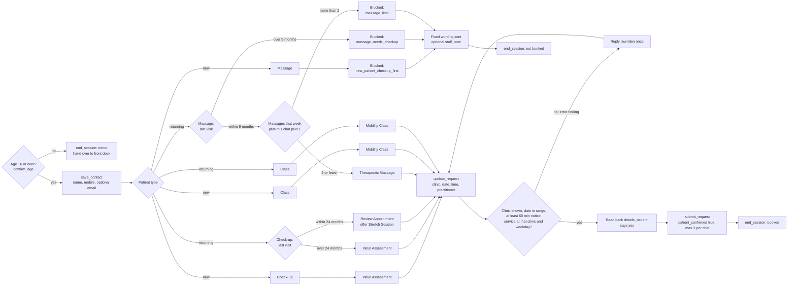

# How the branching logic leads to actions

The agent has no tools. It writes `[[ACTION name {json}]]` notes at the end of
its replies, and `src/agent/checks.js` runs the pure rules in `src/rules/` on
them. The diagram shows which branch of `evaluate()` ends in which outcome.

## Notes

- Blocked outcomes use the fixed wording in `src/rules/templates.js`, so the
  model cannot improvise a refusal.
- A request cannot be submitted until contact details are saved
  (`contact_first`) and the age check has passed (`age_first`).
- `flag_behavior` gives a warning, then ends the session at two strikes.
- Missing facts (service, last visit, clinic, date, massages that week) do not
  branch. They produce a `missing` finding and the agent asks one question.
